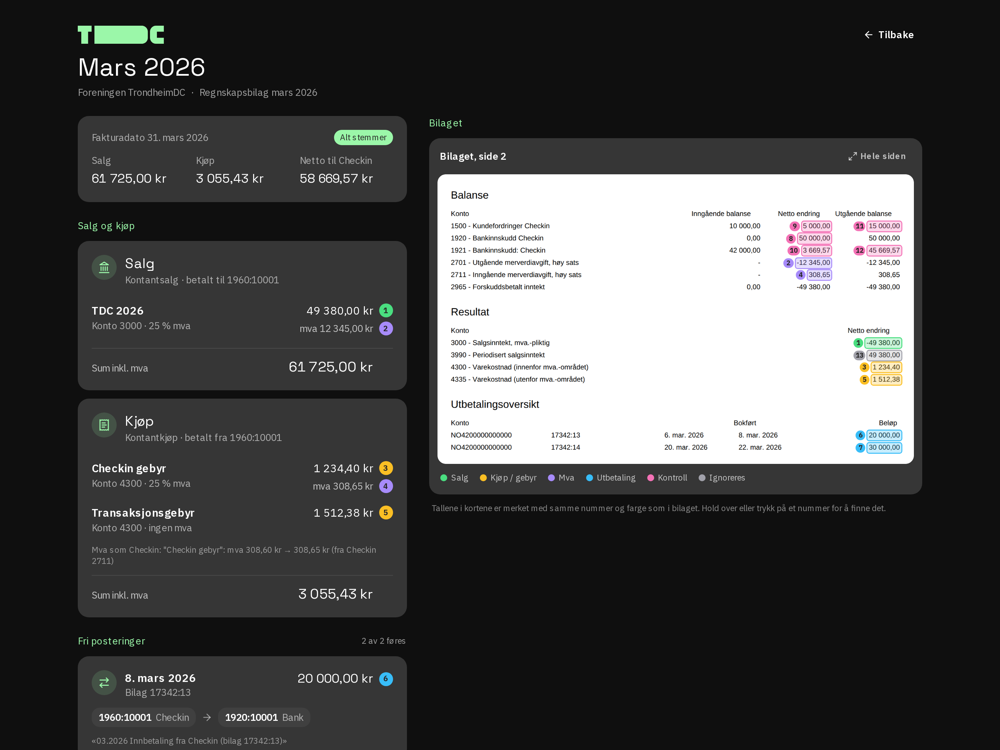

# TDC Regnskap

Books Checkin's monthly accounting report in Fiken: one sale (ticket revenue), one purchase (Checkin fees), and one fri postering per payout to the bank.

The web app and `pnpm foring` share `src/lib`. Nothing is written to Fiken until the numbers have been checked and you confirm.



## Stack

- **Next.js** (App Router, static export) + **React** + **Tailwind**
- **TanStack Query** for Fiken data
- **Zod** for the recipe and the API responses we depend on
- **unpdf** (pdf.js) to read the bilag in the browser

Login is OAuth with PKCE in the browser. api.fiken.no has no CORS, so nginx (and `next dev`) proxies `/api/fiken`. The recipe is `regnskap.config.json`, built into the app.

## Develop

### With Mise

```bash
mise install
cp .env.example .env.local   # NEXT_PUBLIC_FIKEN_CLIENT_ID=...
mise run install
mise run dev
```

Open [http://localhost:3000](http://localhost:3000).

**Tasks:** `mise run install` | `mise run dev` | `mise run build` | `mise run check`

### Without Mise

Install Node and pnpm.

```bash
pnpm install
pnpm dev
```

### CLI

```bash
pnpm foring login                 # OAuth in the browser
pnpm foring report                # dry-run: read the inbox bilag and check it
pnpm foring report --mode create  # book, after confirmation
```

The token is stored in `~/.config/trondheimdc-regnskap/oauth-token.json`. Tests use a generated PDF (`test/pdf-fixture.ts`). Do not commit a real regnskapsbilag.

## Further reading

| Doc | Contents |
|---|---|
| [docs/foring.md](docs/foring.md) | How a month is booked, the checks, and the fri posteringer |
| [docs/deploy.md](docs/deploy.md) | Fiken app, nginx, and DNS. GitHub Actions are off until we deploy |
| [TODO.md](TODO.md) | What is still unverified against Fiken |
