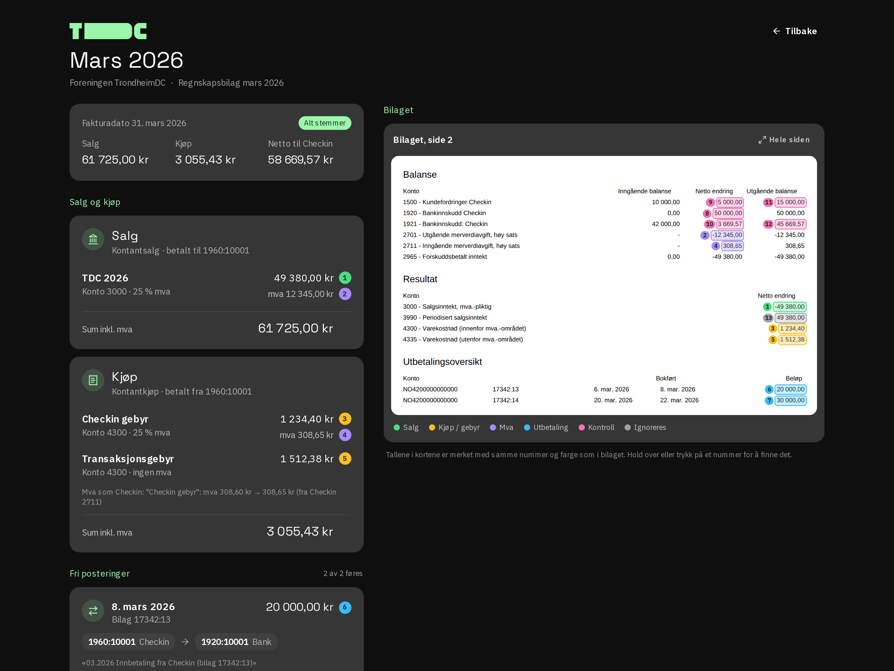

# TDC Regnskap

Books Checkin's monthly accounting report in Fiken: one sale (ticket revenue), one purchase (Checkin fees), and one fri postering per payout to the bank. Also books the hotel's conference invoice as one supplier purchase, split into categories. And books utleggsrapporter (expense claims) from the utlegg form as one supplier purchase from the person, a line per receipt.

It is a web app, live at https://regnskap.trondheimdc.no. Nothing is written to Fiken until the numbers have been checked and you confirm.



## Stack

- **Next.js** (App Router, static export) + **React** + **Tailwind**
- **TanStack Query** for Fiken data
- **Zod** for the recipe and the API responses we depend on
- **unpdf** (pdf.js) to read the bilag in the browser

Login is OAuth with PKCE in the browser. api.fiken.no has no CORS, so nginx (and `next dev`) proxies `/api/fiken`. The recipe is `regnskap.config.json`, built into the app.

## Use

Open https://regnskap.trondheimdc.no (it works on a phone) and log in with Fiken. Only users added as *Godkjente brukere* on the Fiken app can log in, see [docs/deploy.md](docs/deploy.md#1-fiken-app-one-time).

| Tab | What it books |
|---|---|
| **Utlegg** | Utleggsrapporter in the Fiken inbox. One supplier purchase from the person, unpaid, a line per receipt. |
| **Checkin** | The monthly regnskapsbilag from the Fiken inbox. A sale, a purchase and a fri postering per payout. A month already booked opens as a check against the bilag instead. |
| **Hotell** | The hotel's conference invoice (EHF). One supplier purchase split into categories. |
| **Ad hoc** | Any of the above as a local PDF, picked or dropped on the page. |

Each review shows the numbers, the checks and where every number is in the PDF. You can move lines to another category or account before booking. «Lag utkast» makes drafts in Fiken, «Bokfør» books for real; both ask for confirmation first, and failed checks must be ticked off. The same month, invoice or report is never booked twice.

How each flow books and what it checks: [docs/foring.md](docs/foring.md).

**Min TDC** (TBD): Min TDC isn't published yet. The review can already check a signature on reports it uploads, but no such reports exist and no key is set. See [docs/foring.md](docs/foring.md#fra-min-tdc).

## Develop

```bash
mise install                 # Node + pnpm
cp .env.example .env.local   # NEXT_PUBLIC_FIKEN_CLIENT_ID=...
mise run install
mise run dev                 # http://localhost:3000, proxies /api/fiken to Fiken
```

Without Mise, install Node and pnpm and run `pnpm install` and `pnpm dev`.

`pnpm dev:mock` runs against an in-memory Fiken (MSW, `src/mocks`) with sample bilag, so you can click through every flow without a Fiken login.

| Command | |
|---|---|
| `mise run check` | Biome, tsc and Vitest. Run before you commit. |
| `mise run build` | Static export to `out/`. Needs `NEXT_PUBLIC_FIKEN_CLIENT_ID`. |

Tests use generated PDFs (`test/pdf-fixture.ts`) and a fake Fiken client. The repo is public: never commit a real bilag, or names, amounts or account numbers from one.

Every push to `main` deploys to production.

## Further reading

| Doc | Contents |
|---|---|
| [docs/foring.md](docs/foring.md) | How a month is booked, the checks, the fri posteringer, the hotel invoice, and utlegg |
| [docs/deploy.md](docs/deploy.md) | Fiken app, nginx, DNS, and the deploy: live at regnskap.trondheimdc.no, every push to `main` deploys |
| [TODO.md](TODO.md) | What is still unverified against Fiken |
